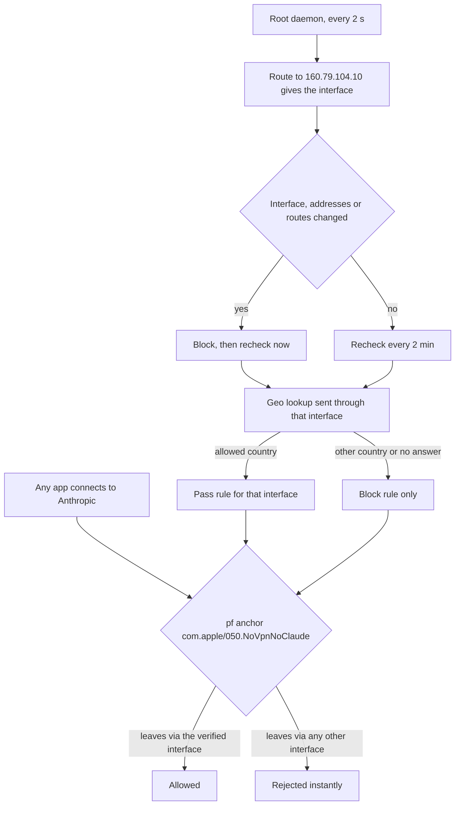

# no-vpn-no-claude

Blocks every connection from a Mac to Claude and Anthropic unless the internet exit is in a country you allow. The block lives in the macOS packet filter, so it covers every app at once, including browsers, Claude Code, the desktop app and usage trackers.

## How it works



The pass rule names the interface where the country was checked. When the VPN drops, the route to Anthropic falls back to Wi-Fi and pf rejects the traffic before the daemon notices anything.

The daemon starts at boot with everything blocked and blocks again on any network change. A VPN server switch inside the same tunnel counts as a change because the endpoint route moves. The daemon holds its own pf reference, reloads its rules if something flushes them, and exits from a hung loop so launchd restarts it blocked. The main pf ruleset and the VPN client's rules are never touched.

The block table holds Anthropic's own ranges `160.79.104.0/23` and `2607:6bc0::/48`, where claude.ai, api.anthropic.com, claude.com, console and docs all live. It also holds the current addresses of the hosts listed in `Sources/Policy.swift`, refreshed every 10 minutes. TCP, QUIC and IPv6 are covered.

Geo lookups go to ipinfo.io, then ifconfig.co, then api.country.is, and only the country code is read. If all three fail on the network verified less than 10 minutes ago, access stays as it was. In every other case Claude is blocked.

## Install

Requires macOS 13 or newer and the Xcode command line tools (`xcode-select --install`).

```bash
gh repo clone LuminiteTime/no-vpn-no-claude && cd no-vpn-no-claude
sudo ./install.sh
```

The installer asks for the allowed countries as ISO codes and whether to add the Claude Code launch check to your shell (zsh or bash). Unattended installs pass both as flags.

```bash
sudo ./install.sh --countries LV,DE --hook
```

Rerun it to update or change countries, the previous list is the default. `sudo ./uninstall.sh` removes everything, the shell hook included.

## Claude Code launch check

With the hook installed, `claude` runs `novpn check` first and passes every argument through unchanged. The check reads the daemon verdict and the current route and sends nothing to the network.

```
✓ no-vpn-no-claude Exit country LV via utun4 · verified 14s ago · allowed LV, DE
✗ no-vpn-no-claude Blocked: exit country is RU
  Claude Code not started, turn on the VPN (allowed LV, DE) and retry
```

The result stays on screen for a second before Claude Code switches to its full-screen view. `command claude` skips the check.

## Menu bar

A shield with a check means Claude is allowed and a crossed shield means it is blocked. Circling arrows show a check in progress. `!` is a firewall problem and `?` means the daemon stopped answering. `⚠︎` appears when a system proxy or iCloud Private Relay is active.

## Limits

An IP block cannot see traffic that leaves through someone else's exit. Browser VPN extensions, system proxies, Private Relay, Tor and Claude served from AWS Bedrock or Google Vertex all pass. Proxies and Private Relay are flagged with `⚠︎`. A Mac that is physically in an allowed country gets access without a VPN, since the rule checks the exit country.

## Files

| Path | Contents |
|---|---|
| `/Library/Application Support/NoVpnNoClaude/` | binary and shell wrapper, owned by root |
| `/Library/LaunchDaemons/local.novpnnoclaude.daemon.plist` | daemon job with the allowed countries |
| `/Library/LaunchAgents/local.novpnnoclaude.tray.plist` | menu bar job |
| `/var/run/novpn-no-claude.json` | current status |
| `/var/log/novpn-no-claude.log` | state changes |

## Development

Plain Swift with no dependencies. `./build.sh` builds `build/novpn` and runs the tests.

| File | Role |
|---|---|
| `Policy.swift` | decisions, pf rules, parsing (pure) |
| `Status.swift` | status file, launch check, tray text |
| `ShellHook.swift` | marked block in the shell rc file |
| `System.swift` | pfctl, route, ifconfig, netstat, curl |
| `Daemon.swift` | guard loop, background DNS, watchdog |
| `Tray.swift` | menu bar icon |
| `Tests/main.swift` | tests |
