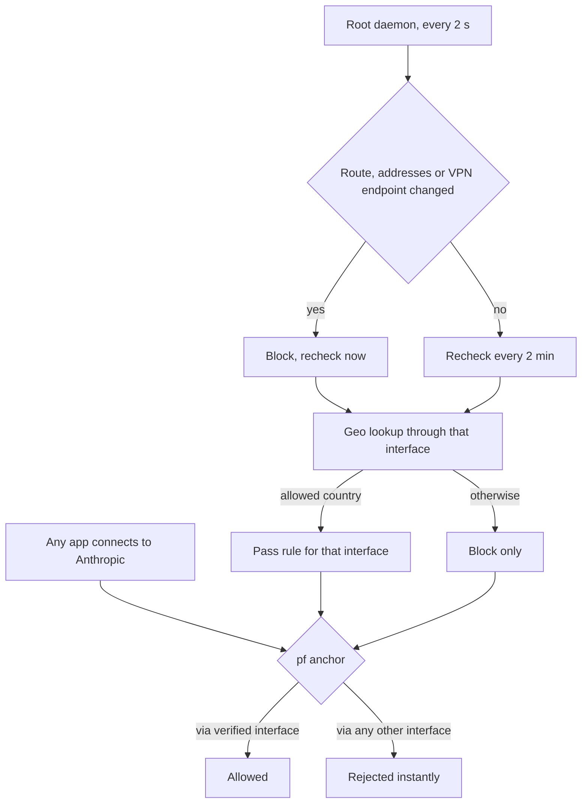

# no-vpn-no-claude

A macOS guard that blocks every connection to Claude and Anthropic unless the internet exit is in a country you allow. Works for all apps at once, browsers included, and starts Claude Code with the time zone of the VPN exit.

## Install

macOS 13+ and Xcode command line tools (`xcode-select --install`).

```bash
gh repo clone LuminiteTime/no-vpn-no-claude && cd no-vpn-no-claude
sudo ./install.sh                                  # asks for countries and the Claude Code hook
sudo ./install.sh --countries LV,DE --hook         # unattended
sudo ./uninstall.sh                                # removes everything, hook included
```

Rerun `install.sh` to update or change countries. Open a new terminal after installing the hook.

## Menu bar

| Icon | Meaning |
|---|---|
| green globe | Claude allowed, exit country verified |
| red crossed globe | Claude blocked |
| blue arrows | country check running |
| orange triangle | firewall problem, see the log |
| gray question mark | daemon not answering, last rules still apply |
| `⚠︎` next to it | system proxy or iCloud Private Relay active, those bypass the guard |

## Claude Code

The hook wraps `claude`. Every flag passes through, `command claude` skips the wrapper.

```
✓ no-vpn-no-claude Exit country LV via utun4 · TZ Europe/Riga · verified 14s ago · allowed LV, DE
✗ no-vpn-no-claude Blocked: exit country is RU
  Claude Code not started, turn on the VPN (allowed LV, DE) and retry
```

The check is local and sends nothing. On success Claude Code runs with `TZ` set to the exit zone, which covers its prompt date, per-turn timestamps and child processes such as `date` and git.

## How it works



- The pass rule names the verified interface, so a dropped VPN is blocked by pf before the daemon reacts.
- Blocked ranges are `160.79.104.0/23` and `2607:6bc0::/48` plus resolved Claude hosts. TCP, QUIC and IPv6 are covered.
- Geo source is ipinfo.io, then ifconfig.co, then api.country.is. The zone must belong to the verified country per `zone.tab`.
- Fail closed at boot, on network change and on failed lookups (a 10 minute grace applies only to the same verified network).
- Self healing. The daemon holds its own pf reference, reloads flushed rules and restarts through launchd if its loop hangs. Other pf rules are never touched.

Not covered are browser VPN extensions, proxies, Tor and Claude through AWS Bedrock or Google Vertex.

## Files

| Path | Role |
|---|---|
| `/Library/Application Support/NoVpnNoClaude/` | binary and shell wrapper |
| `/Library/LaunchDaemons/local.novpnnoclaude.daemon.plist` | daemon and allowed countries |
| `/Library/LaunchAgents/local.novpnnoclaude.tray.plist` | menu bar |
| `/var/log/novpn-no-claude.log` | state changes |

Development is plain Swift without dependencies. `./build.sh` builds and runs the tests.
